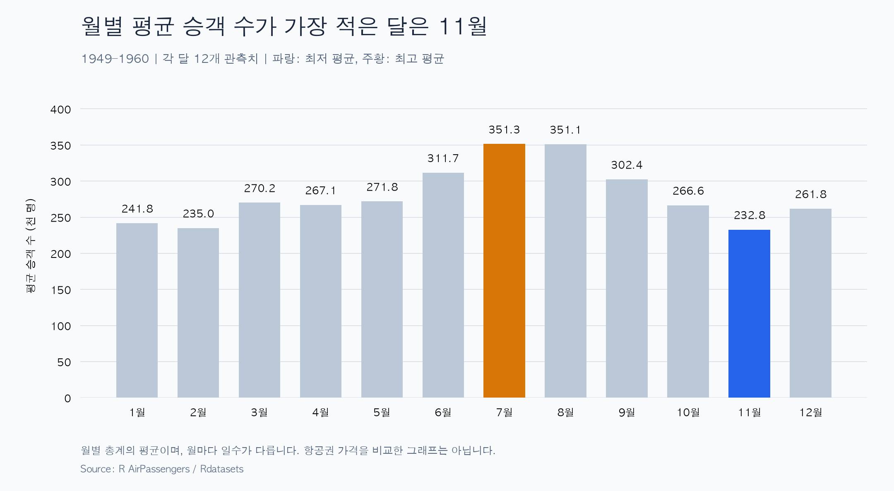
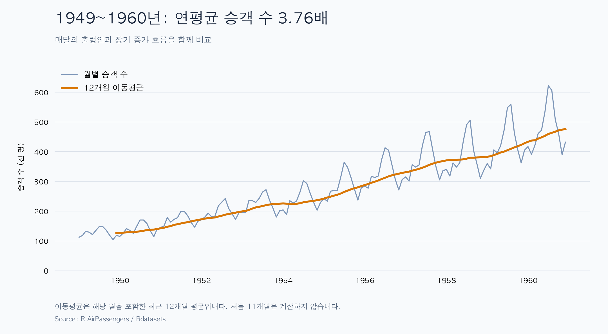

# M1-1 월별 항공 승객 수 트렌드 분석

1949~1960년 AirPassengers 월별 자료 144개로 전체 증가 흐름, 반복되는 월별 차이, 초기·후기 변동 폭을 분석한다. Python 코드, 그래프 2개, 리포트와 재실행 방법을 제공한다.

사용자의 출발 질문은 **“여행객이 적은 달에는 항공권도 저렴할까?”**였다. 이 자료에는 가격이 없으므로 승객 수의 패턴을 확인하고, 가격에 대한 생각은 추가 검증할 가설로 남겼다.

## 결과 먼저 보기

| 분석 질문 | 확인한 결과 |
| --- | --- |
| 전체 흐름은 어떻게 변했는가? | 월별 승객 수의 연평균이 1949년 126.667천 명에서 1960년 476.167천 명으로 약 275.9% 증가 |
| 승객이 많거나 적은 달이 반복되는가? | 평균은 11월 최저, 7월 최고. 연도별 최고는 7~8월, 최저는 11월·2월·1월 |
| 초기와 후기의 변동 폭은 다른가? | 연중 최대−최소가 44천 명에서 232천 명으로 증가. 연평균 대비 폭도 34.7%에서 48.7%로 증가 |

[REPORT.md](REPORT.md)에 수치·관찰·해석·한계를 정리했다.

## 미션 제출 체크리스트

| 필수 항목 | 결과물 |
| --- | --- |
| 데이터 100개 이상 | AirPassengers 월별 144개, 출처·기간·단위 기록 |
| 분석 질문 3개 이상 | 리포트의 질문 1~3 |
| 결측치·이상치 처리 기준 | 누락·중복·결측 0개, IQR 기준 후보 0개, 원본 144개 보존 |
| 분석 기법 2가지 이상 | 월별 집계, 12개월 이동평균, 연도별 통계 |
| 시각화 2개 이상 | 월별 평균, 전체 기간·이동평균 |
| 근거가 있는 인사이트 3개 이상 | 관찰·해석·활용을 구분한 인사이트 4개 |
| 결론·한계·AI 사용 로그 | REPORT.md에 포함 |
| 재현 방법·라이브러리 버전 | 이 문서와 requirements.txt |

- [x] 최종 재실행과 계산·이미지·문서 링크 검증 완료 확인
- [ ] GitHub에 코드·문서·이미지·수집 방법 업로드 확인

최종 실행 결과와 업로드 결과를 확인한 뒤 위 두 항목을 표시한다.

## 데이터와 처리 흐름

한 행은 한 달의 국제 항공 승객 수다. 단위는 천 명으로, 112는 112,000명을 뜻한다. 원본 열은 rownames, time, value이다.

| 항목 | 설계 |
| --- | --- |
| 입력 | data/AirPassengers.csv의 월별 승객 수 |
| 처리 | 월 날짜 변환·점검, 월별 평균·연도별 통계·12개월 이동평균 |
| 조건 | 유효한 양수, 관측치 100개 이상, 연속된 월, 연도별 12개월 여부 |
| 출력 | 그래프 2개, 계산 근거 JSON, 검증 기록 |
| 실패 시 | 파일·값·날짜·비교 범위가 잘못되면 중단하고 원인 표시. 임의 보간·삭제하지 않음 |

실행 흐름은 **파일 읽기 → 점검 → 계산 → 그래프·근거 저장 → 독립 대조**다.

전체 원본 값에 IQR 기준을 적용한 이상치 후보는 0개여서 144개를 모두 보존했다. 전역 기준이 국소 오류까지 발견하거나 자료의 정확성을 보증하는 것은 아니다.

출처·수집 방법·이용 조건은 [데이터 안내](data/README.md)에 있다. 원본 CSV는 로컬에 두고 공개 저장소에는 수집 코드와 출처를 제공한다.

## 실행 방법

Python 3.12.14와 Matplotlib 3.11.2 환경을 사용한다. 의존성은 [requirements.txt](requirements.txt)에 고정했다. 프로젝트 폴더에서 실행한다.

### 처음 실행할 때

~~~bash
python3.12 -m venv .venv
.venv/bin/python -m pip install -r requirements.txt
.venv/bin/python download_data.py
.venv/bin/python inspect_data.py
.venv/bin/python analysis.py
.venv/bin/python verify.py
~~~

### 환경과 데이터가 준비된 경우

~~~bash
.venv/bin/python inspect_data.py
.venv/bin/python analysis.py
.venv/bin/python verify.py
~~~

Windows에서는 .venv/bin/python 대신 .venv/Scripts/python.exe를 사용한다. Python 실행 명령은 설치 환경에 따라 python 또는 py -3.12일 수 있다. 한글 글꼴이 없는 환경에서는 그래프를 영어로 표시한다.

인터넷은 최초 설치와 데이터 다운로드에 필요하다. 로컬 분석·검증에는 필요하지 않다.

## 코드와 실행 증거

| 파일 | 역할 |
| --- | --- |
| [download_data.py](download_data.py) | 원본 CSV와 수집 메타데이터 저장 |
| [inspect_data.py](inspect_data.py) | 날짜·개수·누락·중복·값 확인 |
| [analysis.py](analysis.py) | 통계·이동평균·이상치 선별, 그래프와 계산 근거 생성 |
| [verify.py](verify.py) | 핵심 계산과 결과물 독립 검증 |
| [REPORT.md](REPORT.md) | 분석 질문·결과·인사이트·결론·한계·AI 사용 로그 |
| [원본 확인 기록](evidence/01_data_check.txt) | 최초 데이터 점검 |
| [월별 계산 근거](evidence/02_monthly_summary.json) | 월별 평균과 연도별 최저·최고 월 |
| [전체 분석 근거](evidence/03_full_analysis.json) | 이동평균·연도별 비교·이상치 선별 |
| [최종 검증 기록](evidence/03_final_verification.txt) | 최종 재실행 검증 결과 |

## 학습자가 확인할 핵심 설명

1. 11월 평균은 12년치 11월 승객 수를 더해 12로 나눈 값이다. 평균이 가장 낮다고 매년 그 달이 최저였다는 뜻은 아니다.
2. 12개월 이동평균은 해당 월을 포함한 최근 12개 값의 평균이다. 처음 11개월은 계산하지 않으며 0으로 채우지 않는다.
3. 승객 수가 적다는 관찰과 항공권도 저렴할 것이라는 가설은 구분해야 한다.

## MVP 이후 확장

대시보드, 시계열 분해·예측, 세 번째 그래프는 필수 결과물 검증 후 검토한다.

질문 주차장: 실제 여행 비용 가설을 검증하려면 최근 같은 노선·예약 조건의 가격과 비교 가능한 승객 수 자료가 필요하다.

**지금 반드시 이해:** 수치로 확인한 사실과 원인·가격에 관한 가설을 구분하고, 같은 코드로 결과를 다시 만들 수 있어야 한다.
